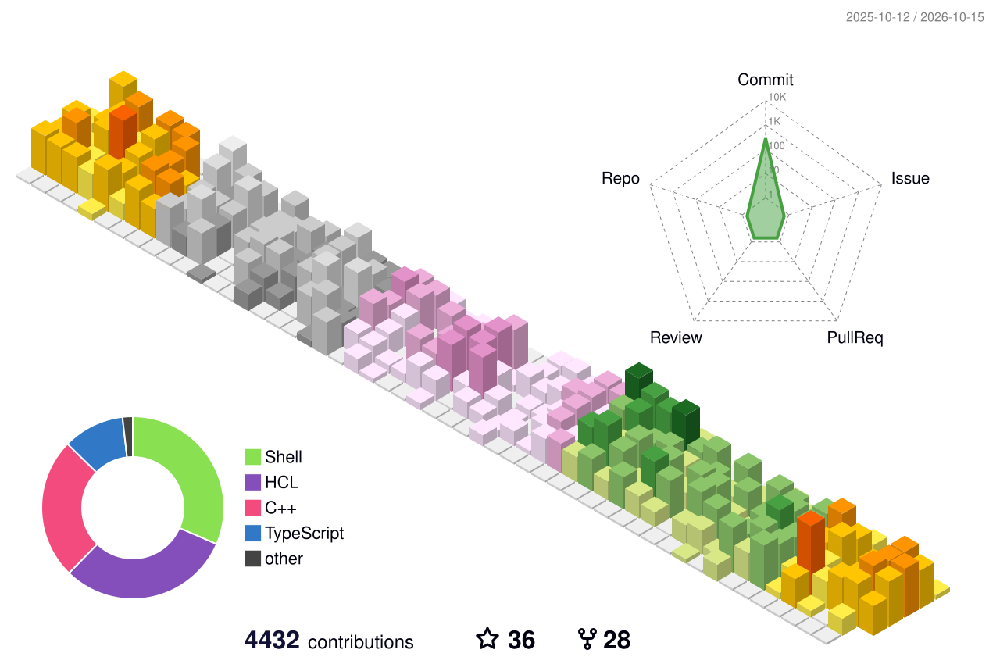

# 👋 Hi I'm Gare

I specialize in building robust backend systems, infrastructure, and managing deployments through Kubernetes. While my focus is on the backend, I'm also comfortable with frontend development. I love doing CTF challenges to expand my knowledge not only in cybersecurity but also in web development and new tech trends.     
  
  

   
  <samp>
    <a href="https://mgarebaldhie.com">me</a> .
    <a href="https://garden.mgarebaldhie.com">second brain</a> .
    <a href="https://www.linkedin.com/in/garebaldhie/" target="_blank">linkedin</a> .
    <a href="https://www.instagram.com/mgarebaldhie " target="_blank">instagram</a> .
    <a href="https://open.spotify.com/user/eragiare " target="_blank">spotify</a> .
    <a href="mailto:mgarebaldhie80@gmail.com">mail</a>
  </samp>

# 🏢 Experiences
| Roles | Company | Duration |
| --- | --- | --- |
| Software Engineer III | [Money Forward](https://moneyforward.com/) | Nov 2024 - Now |
| Software Engineer | [Matchmade](https://www.matchmade.io/) | Mar 2023 - Sep 2024 |
| Software Engineer Intern | [Makmur](https://www.makmur.id/id) | May 2023 - Aug 2023 |
| Software Engineer Intern | [Garena](https://garena.co.id/) | Aug 2022 - Nov 2022 |
| Software Development Engineer Intern | [Sayurbox](https://www.sayurbox.com/) | Nov 2021 - Jul 2022 |
 
# 🏆 Github Stats
<!-- 

 -->

